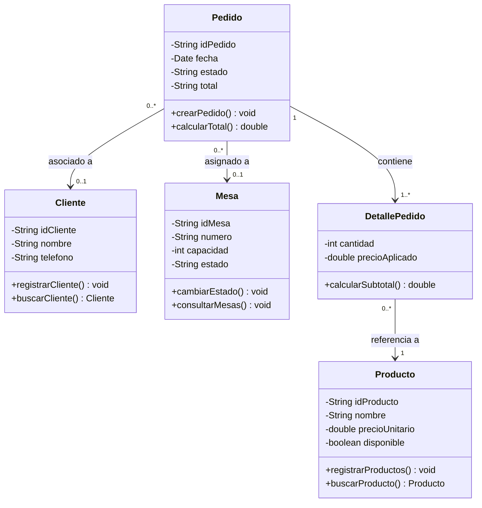

**Entorno de Base de Datos:** MySQL

**Lenguaje / Entorno:** Java 21 (NetBeans 22)

## 1. Diagrama de Clases UML (Modelo de Referencia)

### Opción A: Renderizable (Mermaid.js)

### Opción B: Vista de Texto / Estructura Tabular

Si la plataforma donde abres el archivo `.md` no soporta bloques de código de tipo `mermaid`, puedes guiarte por esta matriz de referencia:

| Clase | Atributos | Métodos | Relaciones | 
| ----- | ----- | ----- | ----- | 
| **Cliente** | `- idCliente: String` `- nombre: String` `- telefono: String` | `+ registrarCliente(): void` `+ buscarCliente(): Cliente` | Referenciado por `Pedido` (0..1) | 
| **Mesa** | `- idMesa: String` `- numero: String` `- capacidad: int` `- estado: String` | `+ cambiarEstado(): void` `+ consultarMesas(): void` | Referenciada por `Pedido` (0..1) | 
| **Producto** | `- idProducto: String` `- nombre: String` `- precioUnitario: double` `- disponible: boolean` | `+ registrarProductos(): void` `+ buscarProducto(): Producto` | Referenciado por `DetallePedido` (1) | 
| **Pedido** | `- idPedido: String` `- fecha: Date` `- estado: String` `- total: String` | `+ crearPedido(): void` `+ calcularTotal(): double` | Apunta a `Cliente` (0..1), `Mesa` (0..1) y `DetallePedido` (1..\*) | 
| **DetallePedido** | `- cantidad: int` `- precioAplicado: double` | `+ calcularSubtotal(): double` | Pertenece a `Pedido` (1) y apunta a `Producto` (1) | 

## 2. Mapeo Completo de Clases, Atributos y Métodos en Java

A continuación se detalla la estructura exacta de atributos y métodos requeridos para la capa **Modelo / Servicios** en Java (`com.restaurante.modelo`), respetando la visibilidad (`-` privado, `+` público) del diagrama UML.

### 2.1 Clase `Cliente`

- **Atributos:**
  - `- idCliente: String`
  - `- nombre: String`
  - `- telefono: String`

- **Métodos Obligatorios:**
  - `+ registrarCliente(): void`
  - `+ buscarCliente(): Cliente`

### 2.2 Clase `Mesa`

- **Atributos:**
  - `- idMesa: String`
  - `- numero: String`
  - `- capacidad: int`
  - `- estado: String`

- **Métodos Obligatorios:**
  - `+ cambiarEstado(): void`
  - `+ consultarMesas(): void`

### 2.3 Clase `Producto`

- **Atributos:**
  - `- idProducto: String`
  - `- nombre: String`
  - `- precioUnitario: double`
  - `- disponible: boolean`

- **Métodos Obligatorios:**
  - `+ registrarProductos(): void`
  - `+ buscarProducto(): Producto`

### 2.4 Clase `Pedido`

- **Atributos:**
  - `- idPedido: String`
  - `- fecha: java.util.Date`
  - `- estado: String`
  - `- total: String`
  - `- cliente: Cliente` *(Asociación UML)*
  - `- mesa: Mesa` *(Asociación UML)*

- **Métodos Obligatorios:**
  - `+ crearPedido(): void`
  - `+ calcularTotal(): double`

### 2.5 Clase `DetallePedido`

- **Atributos:**
  - `- cantidad: int`
  - `- precioAplicado: double`
  - `- producto: Producto` *(Asociación UML)*

- **Métodos Obligatorios:**
  - `+ calcularSubtotal(): double`

## 3. Adaptación Técnica para la Base de Datos (MySQL)

Al realizar el mapeo relacional en **MySQL**, se aplican los siguientes criterios para mantener la consistencia con las clases:

1. **Atributo `total` en la Tabla `Pedido`:** En la base de datos se almacena como `DECIMAL(10,2)` para permitir que el método `calcularTotal(): double` opere con precisión contable.
2. **Claves Foráneas (FK):**
   - Tabla `Pedido`: contiene `id_cliente` (hacia `Cliente`) e `id_mesa` (hacia `Mesa`), ambas opcionales (`NULLABLE`).
   - Tabla `DetallePedido`: contiene `id_pedido` (hacia `Pedido`) e `id_producto` (hacia `Producto`).
3. **Clave Primaria de `DetallePedido`:** Se añade la clave primaria sintética `id_detalle INT AUTO_INCREMENT PRIMARY KEY`.
4. **Campo `disponible`:** En MySQL se mapea a `TINYINT(1)` (1 = `true`, 0 = `false`).

## 4. Instrucciones Generales de Desarrollo

1. **Estructura del Proyecto:**
   - Desarrollar en **NetBeans 22** con **JDK 21**.
   - Paquetes de trabajo:
     - `com.restaurante.modelo` (Contiene las 5 clases UML y sus métodos).
     - `com.restaurante.dao` (Persistencia JDBC hacia MySQL).
     - `com.restaurante.controlador`
     - `com.restaurante.vista` (Interfaz Swing).
     - `com.restaurante.config` (Conexión a base de datos).

2. **Reglas y Validaciones:**
   - Cantidades e importes deben ser mayores que cero.
   - No se pueden agregar productos con `disponible = false`.
   - Los pedidos en estado *Cerrado* o *Completado* son inmutables.
   - Cada modificación en `DetallePedido` debe invocar automáticamente la actualización de `calcularTotal()`.

3. **Validación Final:**
   - Probar el proyecto con `Clean and Build` en NetBeans 22 antes de crear la carpeta de entrega final `Proyecto_GTGP`.
